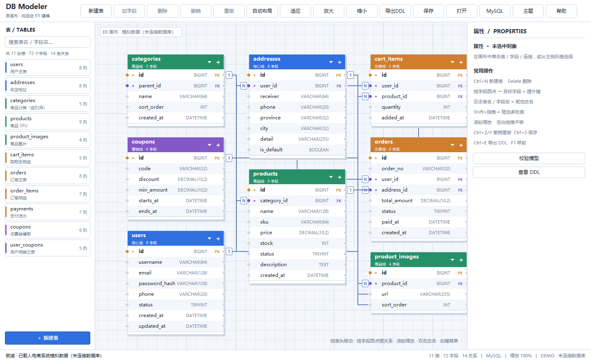

# dbmodeler · 单画布纯自绘数据库建模示例

> 属于 `examples/wg` 示例集合，参考同目录的 `canvas_ime`（单画布 / 自绘输入框 / IME）
> 与 `showcase`（渲染管线契约）编写。**窗口里就能完成一套 ER 建模流程，全部是内存模拟数据，
> 不建立任何数据库连接、不执行任何 SQL。**

Form 是唯一持有 HWND 的对象；挂在窗口下的一张 `ICustomGraphicControl` 是无句柄画布；
工具栏、左侧表导航、右侧属性检查器、状态栏、右键菜单、DDL/帮助弹窗、就地改名输入框，
全部是画在同一张画布上的纯 Go 对象——**零 LCL 控件实例、零句柄、零原生输入框**。

> **真实性约定**：唯一假的东西是**数据源**（内存里的模拟模型，不连数据库、不执行 SQL）。
> 界面里每一个可点的东西都是真功能——按钮真的改模型、菜单项真的执行、快捷键真的绑定、
> 输入框真的能点选光标/拖选/横向滚动、滚动条真的能拖、基数与 `ON DELETE` 真的写进 DDL、
> 保存/打开/导出真的读写磁盘。并由 `--uitest`（逐个按钮/菜单/快捷键）与 `--wintest`
> （向真实 HWND 投递鼠标/键盘/滚轮消息）自动验证，见第五节测试矩阵。



## 一、功能（基础常用功能全覆盖）

| 分类 | 功能 |
|---|---|
| 表 | 新建（自动唯一名 `new_table` / `_2` / `_3`，落点避让已用格子、保证在视口内）/ 复制 / 删除（级联删关系）/ 改名（双击就地改，支持中文）/ 注释 / 分组配色 / 折叠展开（可撤销）/ 拖动移动 / 多选批量删除、左对齐、顶部对齐 |
| 字段 | 添加（折叠自动展开）/ 删除 / 上移下移（越界给提示且不污染撤销栈）/ 改名 / 类型下拉（15 种）/ 长度精度 / 默认值 / 注释 / PK·NN·UQ·AI 勾选 / FK 标记 |
| 关系 | 从字段右侧圆点拖到目标表字段或表头即建外键；正交折线 + 1/N 基数标记；选中后改约束名、基数（1:N / 1:1 / N:M）、ON DELETE；删除；自引用关系（categories.parent_id）。**基数真的改 DDL**：1:1 加 `UNIQUE`、N:M 展开成真实中间表 |
| 画布 | 点阵网格、拖拽平移、滚轮以鼠标为锚点缩放、+/- 缩放、适应窗口、按外键关系分层自动布局、框选多选、方向键微调表位置 |
| 编辑 | 60 步撤销 / 重做（无变化的操作不入栈）、表名与字段名重复校验、模型校验（表/字段空名、空表、重复或空关系名、悬空关系、外键类型或长度不一致、被引用列不是 PK/UQ、`AI` 用在非整数列、`PK`+`UQ` 重复声明、`SET NULL` 用在 `NOT NULL` 外键、未知基数/`ON DELETE`、1:1 自引用）、搜索过滤（表名 / 注释 / 字段名） |
| 输出 | DDL 预览弹窗（带行号、滚动、复制 SQL）、导出 `schema.sql`（写盘失败会在弹窗副标题报错），支持 **MySQL / PostgreSQL / SQLite** 三种方言：MySQL/PostgreSQL 用 `ALTER TABLE ... ADD CONSTRAINT`，SQLite 在 `CREATE TABLE` 内联 `FOREIGN KEY`；列注释按方言落到 `COMMENT` 或 `--` 行；`Ctrl+S` 保存 `model.json`、`Ctrl+O` 读回 |
| 界面 | 明暗主题、hover / disabled 状态、状态栏实时提示与统计、右键上下文菜单（表 / 关系 / 画布）、F1 帮助弹窗；**三处滚动条（导航列表 / 弹窗 / 属性面板）都能拖动、点轨道翻页**；全自绘输入框支持鼠标点选光标、拖动选区、双击选词、长文本横向滚动、Esc 取消本次输入、Ctrl+A/C/V/X、Ctrl+Z/Y 文本级撤销、按词移动、IME 预编辑与候选框定位 |
| 模拟数据 | 预置「电商系统」模型：11 张表 / 72 字段 / 14 条外键关系（用户、地址、分类、商品、图片、购物车、订单、明细、支付、优惠券、领券记录），按业务域配色 |

## 二、运行

在 `E:/app/workspace/examples` 下执行（`go.work` 已 `use ./examples`，无独立 go.mod）：

```bash
go run ./wg/dbmodeler                          # 打开建模窗口（1440×880）
go run ./wg/dbmodeler --selftest               # 无窗口：13 项纯逻辑 + 交互自检（内含 17 项事件链路）
go run ./wg/dbmodeler --uitest                 # 无窗口：17 项逐按钮/逐菜单/逐快捷键断言
go run ./wg/dbmodeler --wintest out.png        # 真实窗口：向 HWND 投递鼠标/键盘/滚轮消息并抓像素
go run ./wg/dbmodeler --smoke                  # 真实窗口画 3 帧后自动退出
go run ./wg/dbmodeler --screenshot out.png    # 无窗口离屏渲染整帧并导出 PNG
go run ./wg/dbmodeler --ddl                   # 打印三种方言的模拟 DDL
go test ./wg/dbmodeler                        # Go 单测
go build -o wg/dbmodeler/dbmodeler.exe ./wg/dbmodeler
```

运行库探测顺序：`ENERGY_LIB` > exe 同目录 > `~/.energy/runtime` > `E:/app/workspace/lib`。
若加载失败：`ENERGY_LIB=E:/app/workspace/lib/libenergy-x86_64-win64.dll go run ./wg/dbmodeler`。

本机实测：

```
==== DBMODELER SELFTEST ====  RESULT: 13/13 PASS
==== DBMODELER UITEST ====    RESULT: 17/17 PASS
[WINTEST] ==== RESULT: 10/10 PASS · 真实窗口消息链路 ====
[SMOKE] PASS frames=3 client=1440x880 tables=11 columns=72 relations=14
go test ./wg/dbmodeler        ok
[SCREENSHOT] OK: dbmodeler_preview.png · 1440x880 离屏整帧渲染
```

## 三、快捷键

| 按键 | 作用 | 按键 | 作用 |
|---|---|---|---|
| `Ctrl+N` | 新建表 | `Delete` | 删除选中的表 / 字段 / 关系 |
| `Ctrl+Z` / `Ctrl+Y` | 撤销 / 重做 | `F2` | 重命名（或双击表头 / 字段） |
| `Ctrl+S` / `Ctrl+O` | 保存 / 打开 model.json | `F1` | 帮助 |
| `Ctrl+E` | DDL 预览并导出 schema.sql | `Ctrl+F` | 聚焦搜索框 |
| `Ctrl+0` | 适应窗口 | `+` / `-` / 滚轮 | 缩放 |
| `Esc` | 取消连线 / 关菜单 / 关弹窗 / 清选择 | 方向键 | 微调选中表（`Shift` 加速） |
| `Shift`+点击表头 | 多选 | `Shift`+空白拖拽 | 框选 |

按键会**按焦点分派**：输入框有焦点时 `Ctrl+Z/Ctrl+Y` 是**文本级**撤销重做（不动模型）、
`Esc` 是**取消本次编辑**并还原成进入编辑前的文本（不会把半成品提交出去）、方向键移动光标；
列表有焦点时方向键是选行、`Home/End/PageUp/PageDown` 翻页；都不是时才落到模型命令。

鼠标：拖表头移动；拖字段圆点到目标字段/表头 = 建外键；空白拖拽 / 中键 / 右键拖拽平移；
表头 `▾` 折叠，`+` 加字段；右键打开上下文菜单；双击表名 / 字段名就地改名；
输入框内点击放光标、拖动选区、双击选词；三处滚动条（列表 / 弹窗 / 属性面板）可拖动、可点轨道翻页。

## 四、架构与沿用的契约

- **事件驱动重绘**：建模器是静态 UI，没有动画，用 `canvas_ime` 的 `OnPaint` 直绘路径，
  不引入 `showcase` 的 60Hz 帧泵 / 静态层烘焙 / AA 光栅器。每次输入只 `Invalidate`，
  静止时零帧。Form `SetDoubleBuffered(true)` + 画布 `CsOpaque` 避免闪烁。
- **画刷顺序**：`Painter.brush()` 先 `SetColor` 再 `SetStyle`（LCL 的 `SetColor` 会重置 Style）；
  文字绘制前刷子置 `BsClear`。
- **软裁剪**：`Painter` 维护一个 `Clip`，所有图元与文本都与它求交；中央 ER 画布先画、
  四周面板随后用不透明底色覆盖，等价于把画布溢出内容裁掉，不需要 GDI clip region。
  这条路同时让 `--screenshot` 可以把同一帧画到离屏 `Pf24bit` 位图上。
- **文本**：`fitText` 按 rect 宽度二分裁剪并加省略号（GDI `TextOut` 无裁剪）；
  字体高度随画布 `zoom` 同步缩放；`fitText` 不重设字体，否则会把标题栏白字染成默认色。
- **输入**：`SetKeyPreview(true)` + `SetOnKeyDown` / `SetOnUTF8KeyPress`；
  `UTF8KeyPress` 会连 Backspace / Ctrl+A / Enter / Tab 的控制字符一起送来，
  必须在事件边界用 `sanitizeText()` 过滤并写回 `*text`；IME 组合串从 IMM32 读取，
  候选框用 `ClientToParent` 转换后的**客户区坐标**定位。
  输入框自己维护 `glyphX[]` 字宽表（CJK 半宽估算）来做「像素 ↔ 字符下标」互转，
  选区、光标点击、双击选词、按词移动、跟随光标的横向滚动都基于它；提交只在 `Enter` /
  失焦发生，`Esc` 会置 `canceled` 并还原文本，让随后的失焦不再触发 `OnSubmit`。
- **WndProc**：接管后每条消息都要 `InheritedWndProc(msg)`；IME 定位放在默认处理之后。
  **滚轮不走 WndProc**：LCL 会按光标位置把 `WM_MOUSEWHEEL` 派给具体控件，因此宿主要用
  `host.SetOnMouseWheel(...)` 接（早期写在 `SetOnWndProc` 里的分支收不到消息，滚轮缩放
  只有模拟事件能触发——这是 `--wintest` 抓出来的真 bug）。
- **软裁剪 + 裁剪栈**：除固定 `Clip` 外还有 `PushClip` / `PopClip`，输入框画超长文本时用它
  把文字裁进编辑区，滚动条画滑块时用它裁轨道。
- **ID 而不是指针**：`TableByID` / `ColumnByID` 返回切片内元素的指针，增删表 / 撤销恢复
  （`Restore` 会整体替换切片）后旧指针失效。UI 状态只存 ID，写回前一律按 ID 重查；
  菜单命令也要先 `uid := t.ID` 再删（删除会就地压实切片，`t.ID` 当场被覆写）。

## 五、测试矩阵（「功能是不是真的」的验收清单）

`--uitest` 无窗口跑，走的是和真实窗口**同一条** `Dispatch` 事件链路，全部用「点真实坐标 →
断言模型/文件变化」的方式，不直接调命令函数：

| # | 用例 | 断言要点 |
|---|---|---|
| 1 | 点击表头选中表 | 命中 `tableAt`，属性面板按新选择重建 |
| 2 | 拖动表头移动 + 撤销 | 坐标真的变了（32×24），撤销后回原位 |
| 3 | 双击就地改名（含中文上屏） | 双击进入编辑 → 上屏 → `Enter` 提交 → 模型名更新 |
| 4 | 拖端口创建外键关系 | 从 `product_images.url` 拖到 `categories.id`，关系数 +1 且列标记 FK |
| 5 | 滚轮缩放 / 右键菜单 / Esc | 缩放 1.00→1.10，菜单 9 项，`Esc` 关闭 |
| 6 | 属性面板输入框提交 | 输入 → 失焦提交 → 表名更新 |
| 7 | 删除表与撤销恢复 | 级联删关系，撤销后表与关系全部回来 |
| 8 | 弹窗与快捷键 | 帮助 35 行、`Esc` 关闭、DDL 弹窗按钮可点 |
| 9 | **工具栏全部按钮** | 15 个按钮逐个点击并验证结果；新建表还断言**整块落在视口内** |
| 10 | **右键菜单全部条目** | 表菜单 5 项 / 关系菜单 3 项 / 画布菜单 8 项，按 `itemTop` 命中每一项并验证 |
| 11 | **快捷键全覆盖** | `Ctrl+N/Z/Y/S/O/E/F/0`、`+`/`-`、方向键 8px 与 `Shift` 40px、`F2`/`Tab`/`Delete`/`Esc`/`F1` |
| 12 | **输入框真实编辑** | 点选光标到 0 / 末尾、拖动选区得到 0..3、`Esc` 还原且**不提交**、`Ctrl+Z/Y` 只动文本、90 字文本产生 `scrollX>0` |
| 13 | **列表/弹窗/属性滚动条** | 三处滑块拖到底（滚动值真的到 `maxScroll`）、点轨道翻页、列表支持键盘选行 |
| 14 | **基数影响 DDL** | 1:1 → 外键列出现 `UNIQUE`；N:M → 生成中间表且不再直接建外键；`ON DELETE` → `CASCADE` 写进 SQL |
| 15 | **字段属性面板全项** | 名字/注释/默认值/类型（切类型清长度）/长度/`UQ` 双向切换/上移越界给提示且不入撤销栈/删除 |
| 16 | **多选与对齐** | `Shift` 多选、左对齐、顶部对齐、批量删除 + 撤销 |
| 17 | **保存/打开/导出落盘** | `Ctrl+S` 写 JSON、改名后 `Ctrl+O` 读回原状、导出 `schema.sql` 与 `DDL()` **逐字节一致** |

`--wintest` 在真实窗口上跑（`PostMessageW`/`SendMessageW` 直接投递到 HWND，不是模拟）：

| # | 用例 | 断言要点 |
|---|---|---|
| 1–2 | 拿到真实 HWND / 客户区尺寸 | `GetClientRect` = 1440×880 |
| 3 | 真实鼠标点击「新建表」 | `WM_LBUTTONDOWN/UP` 打到 (234,27)，表数 11 → 12 |
| 4 | 真实鼠标拖动表头 | 4 段 `WM_MOUSEMOVE` 拖 +64,+48，模型坐标同步变化 |
| 5 | 真实滚轮缩放 | `WM_MOUSEWHEEL(delta=+120)` 送到画布中心，1.00 → 1.10（用 `SendMessage` 取同步结果） |
| 6–7 | 真实 `F1` / `Esc` | `WM_KEYDOWN` 打开帮助，`Esc` 关闭 |
| 8–10 | 点击搜索框 + `WM_CHAR` 输入 "users" | 过滤生效剩 1 张表，`Esc` 还原过滤 |
| 11 | 抓真实窗口像素 | `PrintWindow(PW_RENDERFULLCONTENT)` + `BitBlt` 兜底 + `CreateDIBSection` 读回 → `wintest_real_window.png` |

`--selftest` 另含 13 项纯逻辑自检（模拟数据规模、建删表级联、字段与关系、三方言 DDL、JSON 往返、
撤销栈、自动布局无重叠、坐标互转、输入框编辑与控制字符过滤、命令与撤销、离屏布局、事件链路）。
Go 单测另有 14 项（含 1:1/N:M 的 DDL 语义、SQLite 内联外键不得吞掉逗号、复制表重名去重、
`Validate()` 能报出每一类真实问题、默认演示模型必须零告警）。

## 六、文件

| 文件 | 作用 |
|---|---|
| `main.go` | 入口、Form、WndProc（IME）、键盘与 UTF8 上屏、命令行分派、运行库探测 |
| `scene.go` | 单画布宿主：布局、工具栏 / 导航 / 属性面板 / 状态栏、事件分派、全部建模命令 |
| `canvasview.go` | ER 画布：网格、表卡片、字段行、端口、正交关系连线、缩放平移、拖拽与命中测试 |
| `model.go` | 纯逻辑模型：表 / 字段 / 关系 CRUD、校验、分层布局、三方言 DDL、JSON、撤销栈、电商模拟数据 |
| `painter.go` / `theme.go` | 唯一接触 `lcl.ICanvas` 的渲染层（软裁剪 / 裁剪栈 / 字体缩放 / 文本裁剪）与明暗主题 |
| `widgets.go` | Button / Label / Input / CheckBox / Combo / List 全自绘控件（含可拖滚动条） |
| `overlay.go` | PopupMenu / Modal（DDL、帮助、校验报告）浮层，弹窗正文可拖滚动 |
| `ime_windows.go` / `ime_other.go` / `ime_consts.go` | Win32 IME 绑定与非 Windows 占位 |
| `screenshot.go` | `--screenshot` 离屏位图整帧渲染 + PNG 导出 |
| `selftest.go` / `model_test.go` | 逻辑自检与 Go 单测 |
| `uitest.go` / `uitest_ui.go` / `uitest_edit.go` | 事件链路用例注册、逐按钮/菜单/快捷键、编辑与滚动条与落盘用例 |
| `wintest.go` / `wintest_windows.go` / `wintest_other.go` | `--wintest` 真实窗口消息注入状态机与 Win32 绑定 |

## 七、边界说明

- **不连接数据库**：模型只在内存里；`model.json` / `schema.sql` 是本地文本文件，
  生成的 SQL 只是文本，不会被执行；状态栏明确标注 `DEMO · 未连接数据库`。
- 关系连线用简单正交折线路由，模型很大时可能穿过其它表卡片；可拖动表或点「自动布局」整理。
- 新建表会优先挑视口里的空白格子；视口被占满时退到「压得最轻」的格子（仍保证在视口内），
  必要时点「自动布局」整理。
- 未实现富文本、多列主键的图形化编辑器（多列 PK 可在字段里逐列勾选，DDL 会合并输出）。
- 未做抗锯齿光栅化与脏区局部提交（静态 UI 不需要）；高 DPI 下沿用 LCL 默认缩放。
